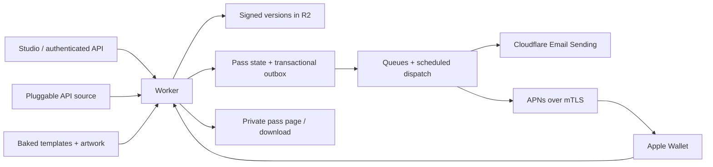

# Wallet

A modular Apple Wallet pass service built for Cloudflare Workers. It issues signed passes, provides private download pages and an administration studio, delivers attachments through Cloudflare Email Sending, and implements Apple's device registration and update protocol.

**Live:** [wallet.plrs.im](https://wallet.plrs.im). The web studio issues and manages passes. Unlock it with the administrator token in your local `.secrets/admin-token` file. See [deployment status](docs/deployment.md#current-status) for verified behavior and remaining device checks.

## Henry’s templates

- [Copper Gym](templates/henrys.pkpasstemplate/) and [Blue Entrance](templates/henrys-blue.pkpasstemplate/) are native Pass Designer bundles. Each contains the original 15 supplied PNGs, including 1×, 2×, and 3× artwork.
- Poster front: member number in the header, member name and home gym in the main fields, membership in the footer. A classic generic layout supports earlier devices.
- Code 39 carries the **exact key tag string**, including leading zeroes. Code 128 follows as the older-device fallback. Do not include Code 39 start/stop asterisks in the input. Confirm the fallback with the gym reader on older devices.
- Two featured actions: membership benefits/account portal and **Go to Location**. The latter uses the selected home gym's verified Apple Maps place ID. All-club eligibility expands location relevance, but the action still targets the home gym.
- Pass Details also provides directions, support, status changes, and member messages. No inferred membership expiry or NFC credential is added.

The app is configured for `https://wallet.plrs.im`, with email from `passes@plrs.im`. The public studio shell needs the administrator token before it can read or change data. The token stays in browser memory.

In the admin panel, search all passes by name, member number, or serial, and filter by template or status. Select **New pass** to choose a template and enter member details, with optional email delivery. Open a saved pass to edit its fields, connect an update source, resend its email, or retry failed deliveries. Routine pass management does not require the CLI.

The pass editor has Details, Delivery, and Updates tabs. Closing it prompts before discarding unsaved changes; refreshing delivery activity and conflicting saves preserve your draft. The [Status page](https://wallet.plrs.im/status) checks D1, R2, artwork, certificate expiry, email acceptance, queues, APNs configuration, and update sources, with separate labels for verified and configured components. HTTP redirects to HTTPS; UUID generation falls back to secure `getRandomValues` for browsers without `randomUUID`.

The browser code lives in `src/admin/client.ts`, styles in `src/admin/studio.css`, and the HTML shell in `src/studio.ts`. The asset build bundles the client separately from the Worker; both TypeScript projects are checked.

Emails use Apple's Wallet badge for a direct `.pkpass` download and a separate **Manage Pass** link to the private member page. Logo and badge images use verified public HTTPS asset URLs for email-client compatibility.

## Stack

| Component | Responsibility |
| --- | --- |
| Workers + Hono + TypeScript | HTTP API, studio, pass personalization, signing |
| Worker Static Assets | Artwork baked into each deployment, accessed through the Worker |
| D1 | Pass data, versions, device registrations, update cursors, durable delivery outbox |
| R2 | Private, immutable signed pass versions |
| Queues + Cron Triggers | Delivery retries, APNs notifications, periodic source refreshes |
| Workers mTLS binding | Production APNs authentication with the pass certificate |
| Cloudflare Email Sending | HTML/text email, signed `.pkpass` attachment, private download link |
| PKI.js + ASN1.js + Web Crypto + fflate | CMS signatures, native RSA signing, ZIP packaging |



R2 storage completes before a D1 compare-and-swap publishes a version. D1's update trigger records the change cursor and push outbox together. A failed upload or competing edit leaves the previous version available. Serial numbers and authentication tokens remain stable across updates.

## Development

Requires Node 24+, npm, and OpenSSL 3. Dependencies are pinned in `package-lock.json`.

```sh
npm ci
npm run credentials -- /path/to/HenrysPass.p12
npm run db:local
npm run dev
```

The import command accepts an empty p12 password by default. For an encrypted export, set `P12_PASSWORD`. It validates the certificate/key pair and WWDR chain, writes `.secrets/` and `.dev.vars` with restrictive permissions, and preserves the existing admin token. The real credential import is already prepared in this workspace; do not commit those files.

Local signed passes still use the configured production update URL. Use `npm run sample` for standalone previews without a web service URL. A real iPhone needs a reachable HTTPS deployment for registration and updates.

```sh
npm run check       # TypeScript, service tests, actual workerd signer test, deployment dry run
npm run test:admin  # Browser workflows against isolated local data; requires Playwright
npm run sample      # Two samples signed using the local Henry's certificate
npm run template    # Portable ZIPs containing editable .pkpasstemplate directories
npm run provision  # D1, private R2, queues, APNs mTLS certificate, email domain/DNS
npm run deploy     # Checks, remote migrations, code + secrets, custom domain, HTTP checks
```

Use [deployment instructions](docs/deployment.md) for Cloudflare access, email onboarding, and the physical-device acceptance test. Use [API documentation](docs/api.md) to issue and update passes. See [extension points](docs/extending.md) to add templates and API integrations.

Browser checks require Playwright and its Chromium browser. If Playwright is installed elsewhere, set `PLAYWRIGHT_PACKAGE` to its absolute `package.json` path. `test:admin` covers creation, editing, search, filters, version conflicts, unsaved changes, delivery refresh, source setup, mobile layout, and the UUID fallback using local fixtures. It does not send external messages. `node scripts/browser-check.mjs` checks the deployed UI without saving changes or sending email.

## Verification and limits

The test suite uses the actual migration and SQLite transactions, verifies every manifest digest, independently verifies CMS with OpenSSL, and exercises registration, cursor updates, token rotation, conditional downloads, concurrent edits, storage failure, email retries, native home-gym actions, and stale-source protection. A separate test invokes **workerd itself** to sign the complete artwork bundle and verify its detached CMS signature.

Provider calls are mocked in service tests. Live issuance through the desktop/mobile web studio, signed R2 downloads, the Wallet registration/update/refetch protocol, and Cloudflare Email Sending acceptance with a real attachment have also been verified. Production APNs mTLS transport was verified using an intentionally invalid token: Apple rejected it and the service removed the test registration. Email `sent` means the provider accepted the message; it does not prove inbox delivery. iPhone rendering, physical barcode scanning, and an actual device receiving a push still require the device acceptance test. APNs acceptance does not guarantee an immediate background refresh.

Delivery is at least once. A process failure after an email provider accepts a message but before D1 records success can cause a duplicate email. Retries use leases, exponential backoff, and a bounded attempt count. Failed deliveries can be inspected and explicitly retried through the API.

Old R2 versions and D1 change records are currently retained. At larger scale, add retention that excludes every `passes.object_key` still in use; do not apply a blanket bucket expiry that deletes current passes. Private links are bearer capabilities: anyone possessing one can download that pass.

## References and choices

[Apple Pass Builder](https://github.com/apple/pass-builder) supports native templates but targets Swift/macOS/Linux. [passkit-generator](https://github.com/alexandercerutti/passkit-generator) provides a mature Node generator, including poster passes. This service uses PKI.js for CMS and the Workers Web Crypto implementation for RSA so generation runs entirely in an isolate; no external signer or Node server is needed.

The format follows Apple's [Poster Generic](https://developer.apple.com/documentation/walletpasses/creating-a-poster-generic-pass), [Pass Designer](https://developer.apple.com/documentation/walletpasses/creating-a-pass-with-pass-designer), [pass packaging](https://developer.apple.com/documentation/walletpasses/building-a-pass), and [update service](https://developer.apple.com/documentation/walletpasses/adding-a-web-service-to-update-passes) documentation. Featured location actions require `placeIdentifier`, as also verified in [passkit-generator's implementation](https://github.com/alexandercerutti/passkit-generator/pull/275).
