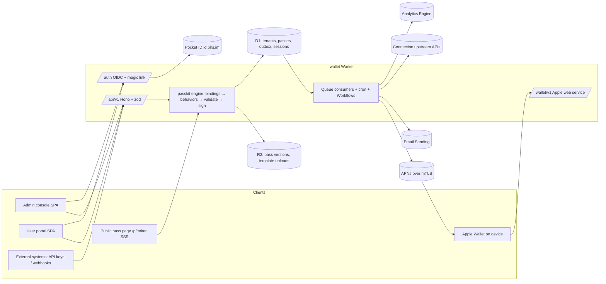

# Wallet platform — architecture and build spec

Status: approved for build (owner delegated all decisions on 2026-10-31). Supersedes the single-tenant design in the baseline commit. Inputs: the seven audits in `docs/audits/2026-10-31/` (A pass engine, B pipeline/data, C security/auth, D frontend, E Cloudflare ops, F quality/tests, G polaris-key reference) and the PassKit catalog in `docs/research/passkit-feature-catalog.md`.

Decisions marked **(call)** were made by the architect without owner input; everything else is the owner's stated requirement.

---

## 1. Intent

A modular, multi-tenant Apple Wallet pass platform on Cloudflare at `https://passbook.mobile` (`PUBLIC_BASE_URL`; `wallet.plrs.im` only redirects there, see `docs/operations.md#domains`). It issues and remotely updates passes for many organizations (companies, gyms, venues, people), each with their own templates and data connections. Henry's Gymnasium (Seattle, two clubs) is the first tenant and the showcase for the feature set.

### Goals
1. **Any number of passes, templates and organizations.** Adding a template or a connection type is quick and plugin-style.
2. **Supports every Apple Wallet pass feature** (all styles, fields, barcodes, relevance, semantics, images, localization, featured actions, NFC when entitled, personalization, multi-pass bundles, update notifications). Henry's templates use as many as reasonable — notably lock-screen relevance near both clubs.
3. **Templates:** baked into the deploy (immutable, non-deletable) **and** uploadable by admins (view, upload, delete uploaded ones).
4. **Remote updates:** manual (admin UI/API) or via API connections (polling, webhooks, inbound machine API). Users can force-refresh their own passes.
5. **Users and admins:** sign in with Pocket ID OIDC (`https://id.plrs.im`) or email magic link. Passes are linked to accounts by email (polaris-key licence-assignment semantics). Direct pass links keep working without sign-in. Admin/user roles come from Pocket ID groups; the shared admin token is removed.
6. **Admin console:** dark-mode-preferred modern redesign. Create/update passes, pass detail with rendered front and back plus status/history, connection and component health, users, orgs, templates, Apple identities, system settings, audit log, API keys.
7. **Cloudflare-native:** use every Cloudflare product that genuinely fits (see §10).

### Non-goals (v1)
- Per-organization admins / org-scoped RBAC. Admins are platform-global. The schema keeps `org_id` on every tenant row so `org_members` can be added later without rewriting queries. **(call)**
- Google Wallet. Order tracking (Wallet Orders). Custom domains per tenant. Running tenant-supplied code.
- Preserving existing issued passes or data (owner: can be wiped). The new `0001` migration replaces the old schema.

### Anti-goals (failure even if it "works")
- An auth or transport failure on a connection ever voids or alters a pass.
- Any secret (signing key, connection credential, session id, magic-link token, download token) logged, returned by an API, or stored in plaintext where hashing/encryption is possible.
- Henry's-specific code in generic modules. Everything tenant-specific lives in template packages or behavior plugins.
- A pass that signs but is rejected by Wallet. Every build runs `validatePass()` before signing.
- Silent catches. Every swallowed error is classified and logged with a stable code.

---

## 2. Key decisions

| Area | Decision |
|---|---|
| Apple identity | **One shared platform identity** by default: Pass Type ID `pass.im.plrs.wallet`, team `48H7CLBV8Y` (cert valid to 2027-11-30; local secrets `SIGNER_PLATFORM_*`). Orgs may later bring their own identity (needed for NFC); each BYO identity needs its own APNs mTLS binding (deploy). The old Henry's ID is retired. |
| Worker topology | One Worker serving API, Apple web service, SSR public pages, queues, cron, workflows and the SPA assets. **(call)** |
| Repo | Single npm package (not a monorepo) with strict directory ownership (§4). npm stays (existing lockfile). **(call)** |
| Frontend | React 19 + Vite + `@cloudflare/vite-plugin` + Tailwind v4 + Radix primitives + TanStack Router (file-based) + TanStack Query + react-hook-form + zod + lucide + sonner + cmdk. **One SPA** with lazy-loaded `/admin` and portal route trees. Public pass page is server-rendered React (zero client JS). Same stack as polaris-key admin. |
| Design system | `@polaris-key/brand` (MIT, `https://pkg.plrs.im/npm/polaris-key/`) tokens + Tailwind theme + fonts, dark-first. If the registry is unreachable, vendor its `tokens.css`/`theme.css`/fonts with the MIT notice. Do not use Polaris Key marks; Wallet gets its own wordmark and accent. |
| API | Hono + zod v4 + `@hono/zod-openapi`; problem+json errors; OpenAPI at `/api/v1/openapi.json`. Shared zod contracts in `src/shared/contracts/` consumed by the SPA. |
| Data access | Raw SQL only inside `repo.ts` files, typed row mappers; hand-written migrations. Tenant-scoped repo functions take `orgId` explicitly. **(call)** |
| Sessions | Opaque 256-bit id in `__Host-wallet_sid` cookie; only SHA-256 stored in D1. Revocable. Not JWT. |
| Email→pass linking | polaris-key licence semantics: `passes.holder_email` + `passes.owner_user_id`, attach on verified email, sticky ownership, explicit reassign, user-removal blocks (§8). One holder per pass. |
| Scheduling | Cron (every minute) finds due connections → starts a `ConnectionSync` Workflow instance with deterministic id (dedupe). No Durable Object in v1. **(call)** |
| Delivery | D1 outbox is the ledger; Queues deliver; consumers throw on transient errors; DLQ consumer finalizes; cron sweeps stale leases. |
| Secrets at rest | AES-256-GCM envelope encryption in D1; KEK is a Worker secret `KEK_V1` (versioned). Secrets Store skipped (single Worker). |
| Tests | vitest 4 projects: `unit` (node), `worker` (`@cloudflare/vitest-pool-workers`, real D1/R2/Queues, all migrations), `web` (jsdom + Testing Library + vitest-axe). Playwright e2e with a local mock OIDC provider. |
| Tooling | Biome (format + lint, 100 cols, 2 spaces, single quotes, semicolons, trailing commas). Strict TS incl. `noUncheckedIndexedAccess`, `verbatimModuleSyntax`. `wrangler types` generates `Env`. GitHub Actions CI file. |

---

## 3. System overview



---

## 4. Repository layout and ownership

```
wallet/
├─ AGENTS.md                      # conventions below, binding for all agents
├─ biome.json  tsconfig*.json  vite.config.ts  vitest.config.ts  wrangler.jsonc  worker-configuration.d.ts
├─ migrations/0001_platform.sql   # single owner per phase (foundation, then integration)
├─ templates/                     # BAKED template packages (data only)
│  ├─ henrys-copper/  (pass.json, wallet.template.json, images, *.lproj/)
│  ├─ henrys-blue/
│  └─ starter-<style>/            # one neutral starter per pass style
├─ src/
│  ├─ passkit/                    # PURE engine, no Cloudflare/Hono imports; node-testable
│  │  ├─ schema/                  # full pass.json types + validatePass() from the catalog
│  │  ├─ template/                # manifest types, expression language, bindings, conditions
│  │  ├─ behaviors/               # BehaviorPlugin registry + venue-locations, …
│  │  ├─ sign/  package/          # manifest, CMS signing, streaming zip, .pkpasses bundles
│  │  └─ index.ts
│  ├─ shared/                     # used by worker AND web
│  │  ├─ contracts/<area>.ts      # zod request/response schemas per API area
│  │  ├─ pass-view/               # normalize(passJson, assets, locale) → PassView (pure)
│  │  └─ email.ts                 # normalizeEmail/strictEmail
│  ├─ worker/
│  │  ├─ index.ts                 # export default { fetch, queue, scheduled } + Workflow classes
│  │  ├─ app.ts                   # mounts one router per module (one line each)
│  │  ├─ platform/                # env, errors (AppError→problem+json), log, clock, ids, crypto (envelope),
│  │  │                           # security-headers, csrf, rate-limit, db helpers, analytics, safe-fetch
│  │  ├─ modules/<area>/          # routes.ts service.ts repo.ts *.test.ts — one owner per module
│  │  │   auth/ users/ orgs/ identities/ templates/ passes/ holders/ delivery/ apple/ public/
│  │  │   connections/ settings/ audit/ status/ metrics/ api-keys/ me/
│  │  ├─ connectors/<type>/       # connector plugins (http-json, webhook, demo)
│  │  ├─ jobs/                    # queue router (kind → handler), cron dispatcher, DLQ
│  │  ├─ workflows/               # TemplateImport, BulkReissue, ConnectionSync
│  │  ├─ ssr/                     # React SSR for /p/:token and auth confirm pages
│  │  └─ email/                   # email templates (HTML + text)
│  ├─ web/                        # React SPA
│  │  ├─ main.tsx  router.tsx  routes/ (file-based)  ui/ (component kit)  lib/ (api client, auth)
│  │  ├─ pass-card/               # <PassCard view face> renderer + barcodes (shared with SSR)
│  │  ├─ admin/  portal/          # feature folders per page
│  │  └─ styles/
│  └─ generated/                  # codegen: baked template index, behavior/connector registries (CI drift-checked)
├─ tools/                         # typed node scripts: build-templates, credentials, provision, deploy, identity-add
├─ test/                          # worker integration helpers, factories, mock OIDC
├─ e2e/                           # Playwright specs
└─ docs/ (design/, audits/, research/, api.md, operations.md, extending.md)
```

Rules (also written to `AGENTS.md`):
- `routes.ts` (HTTP + validation) → `service.ts` (rules, no Hono import) → `repo.ts` (the only place SQL appears).
- Domain code throws `AppError` subclasses with stable codes; only `platform/errors.ts` maps to HTTP.
- Inject `clock` and `ids` via context; no direct `Date.now()`/`crypto.randomUUID()` in services.
- Structured logs `{event, requestId, orgId, code}`; never log personalization, emails, tokens, or URLs containing capability tokens.
- Registries (behaviors, connectors, baked templates) are generated by `tools/build-templates.ts`/codegen. Adding one never edits a shared index by hand.
- Files ≤ ~300 lines; named exports; kebab-case; tests beside code (`*.test.ts`), worker integration tests in `test/` or beside modules under the `worker` vitest project.

### 4a. Copy and docs (owner rule)

No pompous, extraneous or unnecessary text anywhere — UI, emails, status, errors, docs, comments, commits.
- UI: short plain labels; no marketing tone or filler ("seamlessly", "powerful", "Welcome to…", "Successfully…"); no explanatory paragraph where a label or empty state suffices. Errors: what happened + what to do, one sentence.
- Docs: task-oriented and terse; no restating the obvious, no verification narratives.
- Comments: only for a non-obvious why. No banners, no restating code.
- Commits: one-line subject; body only when needed.

---

## 5. Data model (`migrations/0001_platform.sql`)

Base: audit B §5.2, with these changes. IDs are TEXT (UUIDv7 or ULID); timestamps INTEGER ms; emails normalized (`trim().toLowerCase().normalize('NFC')`, no plus/dot stripping); every FK child column indexed; `PRAGMA foreign_keys` honored by D1.

- **orgs** (id, slug UNIQUE, name, status, default_identity_id NULL → platform default, branding JSON (accent, logo asset), created/updated).
- **users** (id, name, primary_email, status active|disabled, created_at, last_login_at, last_roles JSON informational). No stored role authority — roles are decided at sign-in from OIDC groups and stored on the session.
- **user_emails** (email PK, user_id, verified_via magic_link|oidc|admin, verified_at).
- **auth_identities** (provider, subject, user_id, email_claim, email_verified, groups JSON, created_at, last_used_at; PK provider+subject).
- **sessions** (id_hash PK, user_id, amr oidc|magic_link, roles JSON, csrf_secret, created_at, last_seen_at, idle_expires_at, expires_at, revoked_at, ip_prefix, user_agent).
- **magic_links** (token_hash PK, code_hash, purpose sign_in|verify_email, email, user_id NULL, browser_binding_hash, redirect_path, created_at, expires_at, consumed_at, attempt_count).
- **counters** (key, window_start, count; PK key+window_start) for daily/global caps the Rate Limiting binding can't express.
- **workflow_runs** (instance_id PK, kind, org_id, target_id, status, started_at, finished_at, error_code) — Workflow instances can't be listed via the binding.
- **oidc_flows** (state_hash PK, nonce, code_verifier, redirect_path, browser_binding_hash, expires_at). Consumed with `DELETE … RETURNING`.
- **api_keys** (id, org_id NULL=platform, name, prefix, key_hash UNIQUE, scopes JSON, created_by, created_at, last_used_at, expires_at, revoked_at). Format `wlt_<prefix>_<secret>`.
- **credentials** (envelope-encrypted: id, org_id, kind pass_signer|connector|webhook, kek_version, iv, wrapped_dek, ciphertext, fingerprint, created_by, created_at, rotated_at). AAD = `id|org_id|kind`.
- **signing_identities** (id, org_id NULL=platform, label, pass_type_identifier UNIQUE, team_identifier, source env|db, env_prefix e.g. `PLATFORM`, credential_id, cert_pem, cert_sha256, not_before, not_after, apns_binding, apns_health unknown|healthy|failing, nfc_enabled, is_default, created_at). The platform row is upserted at startup from env (`SIGNER_PLATFORM_*`, `PLATFORM_PASS_TYPE_ID`, `PLATFORM_TEAM_ID`).
- **templates** (id, org_id NULL = platform starter usable by any org, slug, name, description, origin baked|uploaded, active_version, status active|archived|deleted, created_by, created_at, updated_at; UNIQUE(org_id, slug)). Baked rows are upserted by `syncBakedTemplates()` (idempotent, keyed by build hash, once per isolate) and are immutable through the API.
- **template_versions** (template_id, version TEXT content hash, manifest JSON, pass_json, assets JSON [{name, slot, scale, locale, size, sha1, crc32, width, height, source}], report JSON, created_by, created_at; PK template_id+version; immutable trigger).
- **passes** (id, org_id, identity_id, serial, template_id, template_version, auth_token, download_token UNIQUE (rotatable), download_token_rotated_at, web_service_url (frozen), personalization JSON, field_sources JSON, display_title, display_subtitle, external_id, status active|voided, version (optimistic lock/ETag), revision (Apple tag), object_key, object_sha256, object_size, modified_at, modified_collision, connection_id, external_ref, link_generation, next_sync_at, last_synced_at, sync_error_code, sync_failures, refresh_requested_at, last_refreshed_at, created_by, created_at; UNIQUE(identity_id, serial); FK (template_id, template_version)).
- **pass_versions** (pass_id, version, object_key, object_sha256, template_version, personalization, pass_json (signed pass.json for history rendering), cause create|admin|api|connection|user_refresh|template_upgrade|resign, actor_type, actor_id, created_at, purged_at).
- **passes.holder_email** (normalized, nullable, indexed) and **passes.owner_user_id** (nullable FK users, ON DELETE SET NULL); **pass_attach_blocks** (pass_id, user_id, created_at; PK both).
- **pass_assets** (pass_id, name e.g. `thumbnail@2x.png`, r2_key `pass-assets/<passId>/<sha1>.png`, sha1, size, width, height, created_at; PK pass_id+name) — per-pass images that override template assets of the same name.
- **devices** (device_id, identity_id, push_token, updated_at; PK device_id+identity_id) and **registrations** (device_id, identity_id, pass_id, created_at). Cap 20 registrations per pass (security C#3).
- **revisions** (AUTOINCREMENT cursor; prune > 7 days; never reset `sqlite_sequence`).
- **outbox** (id, org_id, kind push|email, pass_id, coalesce_key UNIQUE, payload, state pending|enqueued|processing|sent|partial|failed|cancelled, attempts, max_attempts, available_at, enqueued_at, lease, provider_id, error_code, created_at, finished_at) and **push_results** (per device).
- **connections**, **connection_runs**, **webhook_events** — as audit B §5.2, plus `default_template_id` and `holder_email_field`.
- **wallet_logs** (redacted device log lines, capped, 7-day retention).
- **audit_log**, **settings** (scope platform|org:<id>, key, JSON value; typed registry), as audit B.
- Triggers: `pass_published` / `pass_created` as audit B (revision bump, `pass_versions` insert with cause from a `passes.pending_cause` column the app sets in the same statement, coalesced push outbox row).

Retention (daily cron `17 3 * * *`): pass versions keep current + last 3 (R2 objects deleted in batches, `purged_at` set); revisions 7 d; outbox sent 30 d / failed 90 d; connection_runs 30 d or last 1 000; webhook_events, magic_links, oidc_flows, expired sessions 7 d; wallet_logs 7 d; audit_log 1 y.

---

## 6. Pass engine (`src/passkit/`)

**Full feature support.** `schema/` holds TypeScript types and a validator for every pass.json key in the catalog (`docs/research/passkit-feature-catalog.md` appendix), including all six styles plus poster variants (`posterGeneric`, poster event tickets via `preferredStyleSchemes`), field dictionaries (all keys incl. `attributedValue`, `changeMessage`, `dataDetectorTypes`, date/number styles, `row`, `semantics`), every barcode format, `locations` (≤10), `maxDistance`, `beacons` (≤10), `relevantDates`, semantic tags, `nfc` (only when the identity has `nfc_enabled`), `featuredActions`, `userInfo`, app association keys, sharing keys, expiration/voided, colors, all event-ticket and boarding-pass enhancement keys, and anything iOS 26+. Unknown keys produce a **warning**, not an error (forward compatibility). Also: localization (`.lproj/pass.strings`, localized images), personalization (`personalization.json` + `personalizationLogo`), and multi-pass bundles (`.pkpasses`, `application/vnd.apple.pkpasses`).

`validatePass(pass, assets, identity)` enforces: required keys, at least one style, unique field keys across the whole pass, field counts per style, colors `rgb()`, ISO 8601 dates, featured-action rules, attributedValue link allowlist (`https:`, `tel:`, `mailto:`), required images per style, image dimensions per slot (audit A §5.4 table), poster fallback style present, identity fields match the signing identity. Errors block signing; warnings surface in the admin.

**Template package** = Apple `.pkpasstemplate` contents + `wallet.template.json` manifest (audit A §5.1): `inputs` (JSON Schema with `x-label`, `x-group`, `x-order`, `x-widget`, `x-enumLabels`, `x-search`), `sample`, `lookups`, `bindings` (targets: field by key incl. `attributedValue`/`label`/`changeMessage`, featuredAction by identifier, barcode index or `*`, allowlisted JSON pointer), `display` (title/subtitle/status expressions for lists), `behaviors` (registered plugin id + config), `requires`. Expression language: interpolation, lookups, conditions only — no loops/functions, bounded CPU. Uploaded templates may use JSON Schema `pattern` only if it passes a static safe-regex check (`templates/package/safe-regex.ts`): at most 200 characters, valid with the `u` flag, no backreferences or lookaround, and no repeated group containing alternation or an unbounded repeat. A pattern that can match input of any length also needs a `maxLength` of at most 512 on the same property. Failures are `SCHEMA_PATTERN` at upload; baked templates are not checked. Input validation uses `@cfworker/json-schema`.

**Build pipeline** (one function used everywhere): resolve template@version → validate input → bindings → behaviors → inject server fields (serial, auth token, webServiceURL, passTypeIdentifier, teamIdentifier, organizationName from org) → strip Pass Designer `_id` keys → `validatePass` → manifest (precomputed asset SHA-1 from template version + SHA-1 of pass.json/strings) → CMS detached signature (keep current PKI.js approach, SHA-256 digest, signingTime, WWDR G4 chain) → streaming STORE zip. `buildPass(..., { force })` supports force rebuilds.

**Behavior plugins** (`BehaviorPlugin { id, version, configSchema, apply(pass, input, config, ctx) }`): `venue-locations` (multi-venue relevance + home-venue place action; used by Henry's), `expiry-from-input`, and whatever Henry's needs per the catalog recommendations. Plugins are trusted code; uploaded templates may reference them by id with config.

**Signing identities:** resolved per pass from `signing_identities`; private keys imported non-extractable and cached per isolate by `cert_sha256`. Env-sourced platform identity reads `SIGNER_<PREFIX>_CERTIFICATE`/`_PRIVATE_KEY`; DB-sourced identities decrypt from `credentials`. Upload format: PEM cert + PKCS#8 key, or PKCS#12 (modern AES-encrypted); legacy 3DES `.p12` → use `npm run credentials`.

---

## 7. Templates (`modules/templates`, `workflows/TemplateImport`)

- **Registry:** `CompositeTemplateRegistry` = baked (generated index from `templates/*/` → static assets + `src/generated/baked-templates.ts`) + uploaded (D1 + R2 `templates/<org>/<templateId>/<version>/<file>`). Versions are content hashes. `resolve(id, version)` cached per isolate (immutable).
- **Baked:** read-only; "Customize" clones into an uploaded copy. Cannot be deleted (API returns 403 `TEMPLATE_BAKED`).
- **Upload:** `POST /api/v1/templates/uploads` (multipart or zip body, own body limit 15 MB) streams to R2 `uploads/`, then the `TemplateImport` Workflow: unzip with limits (≤100 entries, ≤5 MB each, ≤15 MB total, ratio cap), path rules, name allowlist, PNG checks via Images binding `.info()` (fallback IHDR parse), derive missing @1x/@2x from @3x via Images `.transform()`, drop unused slots with warnings, pass.json + strings validation, manifest validation (optional on upload — if absent, a manifest is generated from field keys so the admin can edit it), dry-run build + sign, persist version, report. Admin sees progress via Workflow status.
- **Delete:** uploaded templates archive (soft) when passes reference them; hard delete (D1 rows + R2 prefix) only when zero passes reference any version.
- **Active version change:** passes always follow their template. A new active version (import, activation, rollback, baked deploy) is picked up by the minute cron (`passes/stale-reissue.ts`, shared with the branding reissue): once the template has been quiet for a minute and holds live passes on another version, one `BulkReissue` Workflow moves them (chunks of 100, CAS publish each, pushes coalesced; voided passes skipped). `templates.reissued_version` records the version queued, so each is queued once. A pass the new version cannot build stays on its version, is logged with the error code and shows on the template page as blocked.
- **Starter templates:** one baked, platform-level starter per style (generic, posterGeneric, storeCard, coupon, eventTicket incl. poster scheme, boardingPass), neutral "Wallet" branding, generated placeholder artwork, each exercising its style's features. They double as renderer and validator golden fixtures.
- **Henry's:** `henrys-copper` and `henrys-blue` rebuilt as manifest packages under org `henrys`, signed with the platform identity, using the catalog's recommended feature set (lock-screen relevance at both clubs per access level with `relevantText`, best `maxDistance`, `changeMessage` on status/membership/home club, semantic tags where meaningful, featured actions, rich back fields with `tel:`/`mailto:`/`https:` links, Code 39 + Code 128 fallback with `altText`, `sharingProhibited`, `expirationDate`/`voided` from inputs, localization scaffold). Fix audit A H1 (duplicate field keys) and M1 (drop unused `background` from the bundle; keep it only as web preview art).

---

## 8. Passes, holders and delivery

**Lifecycle** (`modules/passes`): create (idempotency key), update (If-Match version), publish = build → R2 put → D1 CAS (`UPDATE … WHERE version=?` RETURNING) with up to 3 re-reads on conflict; never set a sync error for a lock conflict. `field_sources` per field (`manual` locks against connection overwrite; "reset to connection" clears). Void/unvoid. Rotate download link. Delete (void first; then removes rows + R2 objects). Pass detail returns current `pass_json`, version history (from `pass_versions` with `pass_json` for rendering any retained version), delivery history, registrations count, connection status, audit trail.

**Holders** (`modules/holders`, polaris-key semantics, audit G §2): state is derived — unassigned (no email, no owner), waiting (email, no owner), owned (owner). Hook A: when an unowned pass gets or changes `holder_email`, attach it to the single user who verified that email (if exactly one and not blocked) with `UPDATE … WHERE owner_user_id IS NULL`. Hook B: when a user verifies an email, attach every waiting, unblocked pass with that email. Owned passes never move automatically; changing the email on an owned pass is an explicit admin **reassign** (clear owner → hook A; audited). A user's **Remove from my passes** writes a block, then clears the owner. Assignment never creates accounts. Both hooks always run the same queries so timing doesn't reveal whether an account exists. Emails normalized with `strictEmail`. Emailing a pass to its holder uses the outbox.

**Delivery** (`modules/delivery`, `jobs/`): outbox rows are created by triggers (push, coalesced per pass) or services (email). Dispatch marks `enqueued` and `sendBatch`es ids after commit. Consumers: claim with lease and `attempts < max_attempts`; push sends **per device** with `apns-push-type: background`, `apns-topic` = pass type id, `apns-priority: 5`, `apns-expiration` = now + 7 days, empty `{}` payload; per-device handling (410/BadDeviceToken/DeviceTokenNotForTopic → delete registration; 429/5xx → retry that device; 403/cert errors → identity `apns_health=failing`); finish `sent`/`partial`. Throw on transient errors so Queue retry with `delaySeconds` backoff applies; DLQ consumer marks `failed` and writes an audit event. Cron every minute sweeps stale leases and re-enqueues lost rows.

**APNs transport:** `ApnsTransport` interface; v1 implementation uses the identity's mTLS binding (`env[identity.apns_binding]`, platform = `APNS`). Missing binding → identity status "push unavailable", passes still update on pull-to-refresh.

**Email:** Cloudflare Email Sending, sender `PassBook <delivery@passbook.mobile>` (`EMAIL_FROM`) for pass delivery and sign-in links **(call — one onboarded sender)**. Pass email: HTML (table layout, `lang`, charset) + text, the pass's icon and the org's name in the band, the pass in its colours with its logo, Add to Apple Wallet badge → direct `.pkpass` paired with Open your pass → `/p/:token` (images from `/p/:token/assets`), optional attachment. Sign-in email: link + 6-digit code, laid out as the hosted sign-in card with the seated buddy; the pass email shows the org's header, with the same buddy when the org opts in (`email.buddy`). Both take colours from the generated tokens.

**Apple web service** (`modules/apple`, under `webServiceURL = ${PUBLIC_BASE_URL}/wallet`): register (201/200, cap per pass), unregister, serials with `passesUpdatedSince`, latest pass with `If-Modified-Since`/`Last-Modified` and 304, log (redacted, capped, rate-limited), personalize endpoint when the template uses personalization (requires an NFC-entitled identity; the platform identity has none, so personalization and NFC are schema/validator/endpoint support without device tests). `Authorization: ApplePass <token>` compared in constant time. Reads use the D1 primary (no replica lag).

**SSR shares the SPA's source:** `npm run gen` compiles the SPA's tokens, kit controls, fonts and holder CSS for SSR pages and emails (`src/generated/ssr-*.css`, `resolved-tokens.ts`; `tools/ssr-parity.test.ts` fails on drift), icons come from `ssr/icon.ts` `iconHtml`, and words from `src/shared/copy/*`. Theme: `requestTheme(c)` reads `wallet-theme`.

**Public pass page** (`modules/public`, `/p/:token`): the portal's `HolderPassView` rendered to static markup with the SPA's CSS for it (`tools/build-ssr-holder.ts`): the shared `<PassCard>` (front + back toggle without JS), Add to Apple Wallet badge, a QR of the page for visitors off the phone, voided/expired notice with the org's support, a quiet link to the holder's portal page, `Referrer-Policy: no-referrer`, `noindex`. Assets under `/p/:token/assets/:name` (immutable cache). Download `/p/:token/pass.pkpass` (ETag/Last-Modified; `application/vnd.apple.pkpass`). Rate-limited. No sign-in required.

---

## 9. Connections (`modules/connections`, `connectors/`, `workflows/ConnectionSync`)

Connector type = trusted code plugin; connection = admin-configured instance per org (audit B §5.3 `ConnectorDefinition` interface, verbatim apart from naming). Core applies `connections.mapping` (template input ← upstream field via pointer + small transforms) and validates with the template's input schema, so connectors stay template-agnostic.

Built-in connectors v1:
- `http-json` — per-record GET with URL template (`{ref}` encoded, `..` rejected), optional list/delta endpoint with cursor, auth from encrypted secrets (bearer, basic, custom header), JSON pointer extraction, `holderEmail` pointer, `test()`.
- `webhook-push` — records arrive in the signed webhook body (no fetch).

Webhooks are a **mode** of a connection (`poll | webhook | hybrid | manual`), not a separate connector combined with another: any connector may implement `verifyWebhook` (HMAC-SHA256 with timestamp, replay window, `webhook_events` dedupe); `http-json` supports it, so a hybrid connection receives refs by webhook and fetches them itself.

Record lifecycle per connection: `auto_create` (default off) creates passes for new upstream refs using `default_template_id`, holder email from `holder_email_field`; `auto_email` (default off) emails newly created passes — off by default so a first sync can't mass-email members; `on_missing` (`keep | flag | void`, default `flag`) handles `not_found`/deleted records. Admins bind an existing pass to a ref on the pass's Connection tab or via API. Per-connection `requestsPerMinute` is enforced by pacing inside the ConnectionSync workflow.
- `demo` — deterministic fake upstream for local dev, e2e and admin demos.

Inbound machine API (API keys with scopes `passes:read`, `passes:write`, `holders:write`, `templates:read`) is the third update path and needs no connector.

Scheduling: cron selects connections with `next_run_at <= now AND enabled AND breaker closed` and creates `ConnectionSync` Workflow instances with id `sync-<connectionId>-<next_run_at>` (dedupe). The workflow pages `listChanges` (or fans `fetchRecord` over due passes respecting `maxConcurrency` and per-connection Rate Limiting), maps, publishes changed passes, writes `connection_runs`, updates health, opens the breaker after 5 consecutive failures (5 min → 1 h, half-open). `generation` fences runs started before a config/credential change. SSRF: HTTPS only, port 443, no IP literals/private ranges/platform hostnames, DNS-over-HTTPS check at save and before fetch, no redirects, 15 s timeout, 256 KB cap, upstream bodies never echoed.

**Force refresh** (user `POST /api/v1/me/passes/:id/refresh`, admin `POST /api/v1/passes/:id/refresh`): authorize, rate-limit (user: 3/min/pass), claim `refresh_requested_at` (30 s coalescing), enqueue `refresh` job (fetch record if connected → publish if changed → **always re-push**), set `last_refreshed_at`. UI polls the pass until `last_refreshed_at ≥ requested`.

Health in admin: status, last success vs interval, failures, breaker, last 20 runs with codes and HTTP status, p50/p95 latency and error rate (Analytics Engine), Test connection.

---

## 10. Auth, users, orgs (`modules/auth`, `users`, `orgs`, `api-keys`, `me`)

**Pocket ID OIDC** (port `../polaris-key/packages/worker/src/core/oidc/client.ts` on `jose`, adapted): discovery cached (isolate + Cache API) with exact issuer pin; Authorization Code + PKCE S256 + state + nonce + RFC 9207 `iss`; `aud`/`azp` exact; `alg` allowlist; `auth_time`/`iat` freshness; JWKS refetch once on unknown `kid`; scopes `openid email profile groups`. Flow state in `oidc_flows` + a `__Host-wallet_oidc` browser-binding cookie. Roles: `groups` contains `OIDC_ADMIN_GROUP` (default `wallet-admins`) → `admin` + `user`; contains `OIDC_USER_GROUP` (default `wallet-users`) → `user`; neither → sign-in refused with an explanatory page. If either env var is unset, that role is never granted. RP-initiated logout when `end_session_endpoint` exists.

**Magic link:** `POST /auth/magic/request {email, turnstileToken, next, prefer}` → Turnstile siteverify (fail closed), rate limits (per email and per IP via the binding; global daily cap via `counters`), always `202` with identical body/timing. A sign-in email is sent only if the address is known (a holder email or a user email) **(call)**. Email contains a link and a 6-digit code; `prefer: 'code'` (sent by the installed app, where a link opens the browser) only reorders the email to lead with the code. Requesting sets a `__Host-wallet_ml` browser-binding cookie; the code is accepted only from that browser on `/login`, while the link works from any browser via confirm-click. Adding a new address from `/account` uses `purpose=verify_email` from a signed-in session and is exempt from the known-address rule. `GET /auth/magic?t=` renders a confirm page (SSR, no JS) whose button POSTs `/auth/magic/consume` — scanners can't burn the token. Token 256-bit, SHA-256 stored, 15 min TTL, single use via `UPDATE … WHERE consumed_at IS NULL RETURNING`, ≤5 code attempts. Magic link grants the `user` role only, never admin. On success: find user by verified email or create one; add `user_emails` row (`magic_link`).

**Sign-in landing and ways back:** one rule, `homeFor(roles, next)` (`src/shared/next.ts`): a safe `next`, else `/admin` for admins and `/` for holders; OIDC, magic link and code, break-glass and an already-signed-in `/login` use it. Every SSR way back (OIDC errors, expired link, no access, refused confirm) links `/login?next=…`. `/login?reason=expired` shows "Your session ended. Sign in again." A browser form post that fails gets the hosted page, never problem+json. Add-email confirm (`GET /auth/magic?t=`) checks the session first: the requesting account gets Confirm, a signed-out browser gets "Sign in to confirm" (`/login?next=/auth/magic?t=…`), another account gets "Switch account" (`POST /auth/logout?next=…`). Success redirects to `/account?verified=<email>`; the portal confirms the address from that parameter and drops it from the URL. `POST /auth/logout?all=1` (CSRF token required) ends every session of the account and still leaves through Pocket ID's end-session; `next=` survives a plain sign-out, and the SPA keeps it in the tab across the end-session round trip.

**Account linking:** identity key is `(provider, subject)`, never email. Pocket ID emails are **trusted** (owner). On every Pocket ID sign-in the email claim is treated as verified regardless of `email_verified`: it is added to `user_emails` (`oidc`), a new `(provider, subject)` identity links to the existing user who owns that email, and attach hook B runs. Setting `oidc.trustEmail` (default on) can switch this to a one-time magic-link proof. Roles never depend on email.

**Sessions:** `__Host-wallet_sid` (`Secure; HttpOnly; Path=/; SameSite=Lax`). Admin-capable sessions: 1 h idle / 12 h absolute; user sessions: 30 d idle / 90 d absolute **(call)**. Rotate on login; sign-out revokes; admins can revoke any user's sessions; disabled users are refused at the next request. CSRF: every non-GET with cookie auth requires same-origin (`Origin` or `Sec-Fetch-Site: same-origin`) **and** `X-CSRF-Token` matching the session's `csrf_secret` (exposed by `GET /api/v1/session`). API-key requests are cookie-free and exempt.

**Users admin:** list/search users, detail (emails, identities with groups, sessions, linked passes, audit), disable/enable, add/remove verified email (`admin`), revoke sessions. Roles are read-only (managed in Pocket ID) with a link to `https://id.plrs.im`.

**Orgs admin:** CRUD orgs (slug, name, branding accent/logo, default identity), per-org view of templates, connections, passes, API keys.

**API keys:** created by admins (platform or org-scoped), shown once, hashed, scoped, expirable, revocable, last-used tracking, rate-limited.

---

## 11. Settings, audit, status, metrics

- **Settings registry** (typed, zod): platform settings (OIDC group names display, trust-email toggle, magic-link enabled, email sender display name, retention windows, force-refresh limits, default identity) and per-org settings (branding, support contacts, pass email buddy). Env vars hold secrets; settings hold policy.
- **Audit log:** every admin/API mutation, sign-in, sign-out, session revocation, key creation, credential rotation, template upload/delete, connection change; redacted JSON diff; filterable in admin.
- **Status** (`/api/v1/status` admin; public `/health` minimal): D1, R2, Queues backlog (`queue.metrics()`; DLQ via a producer binding), recent Workflow failures from `workflow_runs`, each identity (cert expiry with 30-day warning, APNs health, binding present), Email Sending, Pocket ID discovery reachability, each connection's health, cron last run, build/version id (version metadata). Honest vocabulary: Verified / Configured / Degraded / Failing / Not configured, sorted by severity.
- **Metrics:** Analytics Engine dataset `wallet_events` (issued, updated, downloaded, registered, unregistered, push result, email result, sync run, refresh, sign-in) with org/template/identity dimensions; admin overview charts query it via the Analytics Engine SQL binding when available, else D1 aggregates.

---

## 12. HTTP surface

| Path | Auth | Purpose |
|---|---|---|
| `/` , `/passes/:id`, `/account`, `/login` | SPA (portal) | user portal |
| `/admin/*` | SPA (admin) — API enforces admin | admin console |
| `/api/v1/session` | cookie | current user, roles, csrf token |
| `/api/v1/me/*` | user session | my passes, refresh, emails, sessions |
| `/api/v1/{orgs,templates,passes,holders,connections,connectors,identities,users,api-keys,settings,audit,status,metrics}` | admin session or scoped API key | admin + machine API (OpenAPI) |
| `/api/v1/openapi.json` | public | API description |
| `/auth/oidc/start`, `/auth/oidc/callback`, `/auth/magic/request`, `/auth/magic`, `/auth/magic/consume`, `/auth/logout` | — | sign-in flows |
| `/wallet/v1/*` | ApplePass token / none per protocol | Apple web service |
| `/p/:token`, `/p/:token/pass.pkpass`, `/p/:token/assets/:name` | bearer link | public pass page + download |
| `/hooks/connections/:id` | connection webhook signature | inbound webhooks |
| `/health` | public | liveness |

`assets.run_worker_first`: `/assets/*`, `/api/*`, `/auth/*`, `/wallet/*`, `/p/*`, `/hooks/*`, `/health`, and file-like paths (`/*.*`) except the files `public/` ships (negated entries, kept in step by `tools/wrangler-config.test.ts`): an unknown `/foo.js` or `/robots.txt.bak` is a 404, never the SPA shell. Every other path is a static asset with `not_found_handling: "single-page-application"`; the SPA draws its own not-found page. Security headers: Worker responses set them in middleware; SPA HTML and static assets get them from `public/_headers`. Strict CSP with no `'unsafe-inline'` scripts (nonce or hash for SSR pages; SPA uses external scripts only), HSTS (`max-age=31536000; includeSubDomains`), `X-Content-Type-Options`, `Referrer-Policy: no-referrer` on `/p/*` and `/auth/*` (else `strict-origin-when-cross-origin`), `Permissions-Policy`, COOP, CORP, `frame-ancestors 'none'`. `Cache-Control: no-store` only on API/auth/session/download responses; hashed static assets and template assets are immutable.

---

## 13. Frontend

**Admin IA** (audit D §5.4): sidebar + ⌘K command palette + top bar (org scope in `?orgId=`, account menu). One `AppShell` frames every page; the account menu is the same everywhere (My passes, Account, Admin for admins, Theme, Sign out). Sections: **Overview** (KPIs, recent activity, health summary, charts), **Passes** (virtualized table with search/filter by org/template/status/connection; New pass wizard: org → template → schema-driven form with live `<PassCard>` preview → holder email → deliver), **Pass detail** (`/admin/passes/:id`: front/back render with version picker, tabs Fields · Holder · Images · Delivery · Versions (diff) · Connection · Devices · Activity; actions: save, void, refresh, resend email, rotate link, copy link, delete), **Templates** (baked locked badge, uploaded deletable, versions, validation report, preview with sample, upload wizard with Workflow progress, clone baked), **Connections** (list with health, detail with runs and Test, create wizard from connector schema, mapping editor), **Users** (list, detail, sessions), **Organizations**, **Apple identities** (cert expiry, APNs health, upload), **API keys**, **Status**, **Settings**, **Audit log**. URL state for filters; unsaved-change guard; If-Match conflict handling that preserves drafts (port current studio behavior as acceptance criteria); toasts; empty/loading/error states; keyboard accessible.

**Portal IA** (audit D §5.5): `/login` (Pocket ID button + magic-link form with Turnstile), `/` (my passes as cards with Add to Wallet, Refresh with pending/done/cooldown, last updated), `/passes/:id` (front/back, details, download, refresh), `/account` (emails with verification, sessions). `/admin/account` renders the same page inside the admin shell.

**Visual direction:** dark-first, light supported (`prefers-color-scheme` + `data-theme` override on every page, from the `wallet-theme` cookie via a small external blocking script `/theme-init.js`, not inline; SSR pages read the same cookie and stamp `data-theme`), Polaris brand tokens and fonts (Rubik, JetBrains Mono), Wallet accent, raised cards, generous spacing, subtle motion respecting `prefers-reduced-motion`. WCAG 2.2 AA (contrast ≥ 4.5:1 text, 3:1 focus/UI, 24 px targets, focus management on route change, live regions).

**Pass renderer:** `normalize(passJson, assets, {locale, strings, now})` → `PassView` (pure, `src/shared/pass-view/`) and `<PassCard view face="front|back" />` (`src/web/pass-card/`) for every style and poster variants, Intl formatting, sanitized links, featured actions, barcodes as SVG (bwip-js, lazy, labelled "approximate"), voided/expired states, scales to container. Used by admin, portal and SSR. Visual baseline tests per starter template.

---

## 14. Cloudflare products

| Product | Use |
|---|---|
| Workers + Static Assets (SPA mode) + Vite plugin | one Worker, SPA + SSR + API |
| D1 (+ Time Travel bookmark before each remote migration) | system of record |
| R2 | pass versions `passes/<passId>/v<version>-<rand>.pkpass`, template assets, `uploads/` (lifecycle: delete after 1 day) |
| Queues (`wallet-jobs`, `wallet-jobs-dlq` with consumer) | push, email, refresh, sync fan-out |
| Cron Triggers (`* * * * *`, `17 3 * * *`) | sweeper + connection scheduling; daily retention + cert expiry |
| Workflows (`TemplateImport`, `BulkReissue`, `ConnectionSync`) | durable multi-step jobs with visible status |
| Email Sending | pass delivery + sign-in |
| mTLS certificates | APNs per identity (`APNS` = platform) |
| Images binding | template image validation + @1x/@2x derivation |
| Turnstile | magic-link request form |
| Rate Limiting binding | login, magic link, public pages, Apple log/register, API keys, webhooks, refresh |
| Analytics Engine (+ SQL binding when available) | per-tenant metrics and admin charts |
| Version metadata binding | build id in logs/status |
| Workers Logs + sampled traces | observability; invocation logs stay off and traces stay disabled until capability-token paths (`/p/:token`, `/auth/magic?t=`) are confirmed absent from span attributes |
| Cache API | OIDC discovery/JWKS |

Skipped with reason: KV (needs strong consistency), Durable Objects (v1 covered by D1 CAS + Workflow ids), Secrets Store (single Worker), Access/Zero Trust (in-app OIDC is the requirement), Hyperdrive, Vectorize, Workers AI, Browser Rendering, Containers, Workers for Platforms (no requirement yet).

---

## 15. Security requirements (checklist for reviewers)

Constant-time token comparison; all tokens ≥ 256-bit from `crypto.getRandomValues`; capability tokens hashed at rest where the plaintext isn't needed (sessions, magic links, API keys); the download token stays retrievable because links must be re-sendable, but it is rotatable and never logged **(call)**; the ApplePass auth token stays retrievable because it is embedded at every re-sign; SQL parameterized; zod validation on every input; body limits per route; no `innerHTML`/`dangerouslySetInnerHTML` except sanitized attributedValue rendering through an allowlist; CSP as §12; SSRF rules §9; upload rules §7; tenant isolation tests for every org-scoped route; secrets envelope-encrypted; logs redacted; audit trail for every mutation; rate limits as §14; Turnstile fail-closed; OIDC checks §10; CSRF §10; session fixation prevented; disabled users blocked; open-redirect-safe `next` parameters (same-origin relative paths only).

---

## 16. Testing

- `unit` (node): passkit (golden `pass.json` per baked template and sample; validator cases per catalog key; CMS verified with OpenSSL; expression language; behaviors), pass-view normalize, email normalization, connectors' mapping.
- `worker` (vitest-pool-workers): every route via `SELF.fetch`; Apple protocol suite (frozen); outbox/queue/DLQ/cron; CAS conflicts; tenant isolation suite; auth flows with a mock OIDC (jose-signed tokens, mocked discovery/JWKS fetch); magic link single use; CSRF; rate limits; webhook signatures; workflows via test helpers.
- `web` (jsdom): components, forms, `<PassCard>` per style, axe checks.
- `e2e` (Playwright, `vite dev`/`wrangler dev`, local D1 seeded by factories, mock OIDC server in `test/mock-oidc/`): admin sign-in, create pass, edit with conflict, upload template, delete uploaded template (baked delete refused), connection create + test + sync with `demo` connector, user magic-link sign-in → sees email-linked pass → force refresh, public link without sign-in, mobile layouts, dark/light screenshots.
- `npm run check` = gen → biome ci → typecheck → test (all projects) → build (vite + wrangler dry-run). Must be green before any merge.

---

## 17. Build plan

1. **Foundation** (one agent, sequential): scaffold per §4, dependencies (latest stable, ≥ 2 weeks old, exact pins), Biome, tsconfigs, Vite + Cloudflare plugin, vitest projects, `wrangler.jsonc` with all bindings (§14) + `wrangler types`, `platform/` layer, full `0001` migration, shared contracts for every API area (§12), module stubs with mounted routers, SPA shell with router, design tokens, `ui/` primitives, `AGENTS.md`, CI workflow, removal of the old `src/`/`scripts/` (git history keeps them), test harness + factories + mock OIDC skeleton. Exit: `npm run check` green.
2. **Parallel build** (one agent per workstream, each in its own git worktree/branch, owning only its directories): (a) passkit engine; (b) pass-view + PassCard renderer; (c) templates module + TemplateImport + baked packages (Henry's + starters) + codegen; (d) passes + holders + delivery + Apple web service + public page + BulkReissue + retention; (e) auth + users + sessions + api-keys + me; (f) connections + connectors + ConnectionSync + force refresh; (g) orgs + identities + settings + audit + status + metrics; (h) admin SPA shell + overview/status/settings/audit/users/orgs/identities/api-keys pages; (i) admin passes + templates + connections pages; (j) portal + login + email templates.
3. **Integration** (one agent): merge branches in dependency order, resolve conflicts, wire registries, make `npm run check` and e2e green.
4. **Review** (parallel reviewers by dimension: security, Apple/PassKit correctness, data/concurrency, Cloudflare best practices, frontend UX/a11y/design, test quality) → adversarial verification → fix agents → re-check.
5. **Docs:** README, `docs/api.md` (from OpenAPI), `docs/operations.md` (go-live), `docs/extending.md` (templates, behaviors, connectors).

---

## 18. Go-live steps that need the owner

1. Pocket ID (`id.plrs.im`): create groups `wallet-admins` and `wallet-users`; create an OIDC client "Wallet" with callback `https://passbook.mobile/auth/oidc/callback` (and `http://localhost:5173/auth/oidc/callback` for dev), PKCE enabled, groups claim included; provide client id/secret.
2. Upload the new platform certificate as a Cloudflare mTLS certificate for APNs (`tools/identity-add.ts` does it with wrangler) and set `SIGNER_PLATFORM_*` secrets.
3. Turnstile widget for `passbook.mobile`; set `TURNSTILE_SECRET`/site key.
4. Generate `KEK_V1`.
5. Create the new queues/workflows/rate-limit namespaces/AE dataset (wrangler deploy auto-provisions most), apply `0001` to a **fresh** D1 (owner approved wiping), deploy.
6. Device acceptance test: add a Henry's pass on an iPhone, verify lock-screen relevance near a club, update push, and barcode scan.

---

## 19. Decisions after builder review (2026-10-31)

- **Henry's live data:** no connector at launch. MemberSpot has no verified API (`docs/research/memberspot/README.md`); Henry's passes are maintained by admins or the machine API. A snapshot connector is a follow-up.
- **Per-pass images** are in v1 (`pass_assets`), uploaded from pass detail or the API and validated with the template image rules.
- **NFC/personalization:** supported in schema, validator and web service; gated on `signing_identities.nfc_enabled`; not device-tested.
- **Rate limits:** the binding (10 s/60 s windows, per location) is for abuse throttling only; daily/global caps use `counters`.
